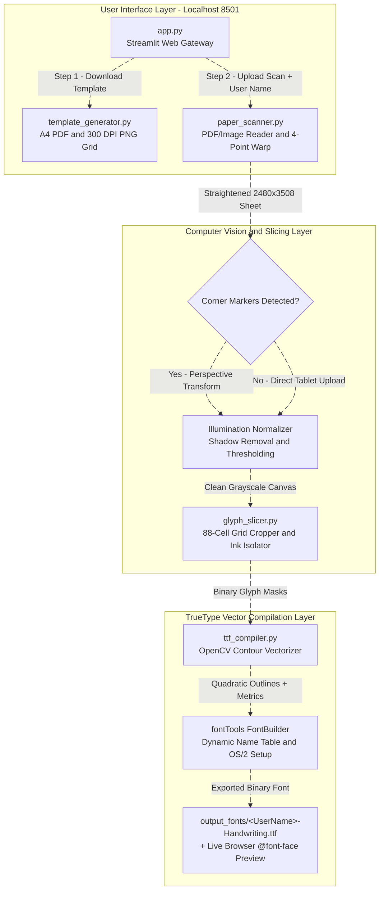

# Handwriting to TTF

A local web application (`http://localhost:8501`) for turning your own handwriting into an installable TrueType (`.ttf`) font from a printed A4 template or tablet scan using OpenCV, FPDF2, and fontTools.

## About

Handwriting to TTF provides a lightweight, local-first pipeline for generating printable character grids, straightening perspective from scanned sheets or camera photos, isolating pen strokes, and compiling custom `.ttf` fonts without external cloud dependencies.

Built and maintained by [T A Srinivas (@SRINIVASTA)](https://github.com), this repository hosts a Streamlit web gateway, an exact-scale A4 template generator, a 4-point corner marker perspective scanner, a binary glyph slicer, and a vector TrueType font compiler.

## Modules in this repo

| Module | Description |
| :--- | :--- |
| `template_generator.py` | Generates printable exact-scale A4 PDF (`blank_template.pdf`) and 300 DPI PNG (`blank_template.png`) character grids with 4 corner bullseye markers and dashed writing baselines. |
| `paper_scanner.py` | Reads uploaded PDF scans (via `pdf2image`) or phone photos, detects the 4 corner registration markers, straightens perspective to a canonical `2480x3508` canvas, and removes paper shadows. |
| `glyph_slicer.py` | Crops the 88 individual character cells from the aligned sheet, strips printed headers and baseline guides, and isolates clean binary pen strokes. |
| `ttf_compiler.py` | Traces OpenCV contours into smooth quadratic TrueType outlines via `fontTools`, applies dynamic `<UserName>-Handwriting.ttf` naming and metadata, and exports the final `.ttf` font. |

### Architecture & Workflow



### Key Capabilities

* **Dual Template Modes (Paper & Tablet):** Download an exact-scale A4 PDF to print and fill with a black pen, or download a 300 DPI PNG to write directly on an iPad, Android tablet, or phone screen.
* **Automatic Perspective & Shadow Correction:** Detects the 4 corner bullseye markers to deskew tilted phone photos and divides out uneven lighting before slicing characters.
* **Dynamic Font Naming & Live Preview:** Enter any custom name to export `<UserName>-Handwriting.ttf` with embedded font family metadata and test typing immediately inside the browser.

## Repository Structure

```text
handwriting-to-ttf/
├── .streamlit/
│   └── config.toml                 # Streamlit theme settings and 50 MB upload limit
├── output_fonts/
│   └── <UserName>-Handwriting.ttf  # Dynamically named TrueType (.ttf) font exported from your scan
├── samples/
│   ├── blank_template.pdf          # Printable exact-scale A4 PDF template with 4 corner markers
│   ├── blank_template.png          # High-res A4 PNG template (for tablet/phone screen writing)
│   ├── sample_filled_paper.pdf     # Example scanned PDF of completed handwriting sheet
│   └── sample_filled_paper.jpg     # Example photo/image of completed handwriting sheet
├── src/
│   ├── __init__.py                 # Shared character map and A4 grid constants
│   ├── template_generator.py       # Generates printable A4 PDF & PNG character grids
│   ├── paper_scanner.py            # Reads PDF/image scan, straightens perspective, cleans white paper
│   ├── glyph_slicer.py             # Crops individual character cells and isolates black pen strokes
│   └── ttf_compiler.py             # Converts character contours into vector glyphs via fontTools
├── .gitignore                      # Ignores venv/, __pycache__/, and generated .ttf fonts
├── app.py                          # Streamlit web UI (Download PDF/PNG -> Upload Scan -> Get .ttf)
├── LICENSE                         # MIT License — Copyright (c) 2026 T A Srinivas
├── packages.txt                    # System dependency (poppler-utils) for reading uploaded PDF scans
├── requirements.txt                # Python dependencies (streamlit, fpdf2, pdf2image, opencv, fonttools)
└── README.md                       # Setup guide, usage instructions, and architecture diagram
```

## Installation & Local Setup

You can clone and run Handwriting to TTF locally across Windows, macOS, and Linux:

### 1. Clone the repository

```bash
git clone https://github.com/handwriting-to-ttf.git
cd handwriting-to-ttf
```

### 2. Install system PDF dependencies

*(Required only if uploading scanned `.pdf` files; `.png` and `.jpg` uploads work out of the box.)*

#### Windows
1. Download and install **Poppler for Windows**.
2. Add the Poppler `bin` folder to your Windows **System PATH**.

#### Ubuntu / Debian
```bash
sudo apt-get update && sudo apt-get install -y poppler-utils
```

#### macOS
```bash
brew install poppler
```

### 3. Set up Python environment

```bash
# Create virtual environment
python -m venv venv

# Activate on Windows
venv\Scripts\activate

# Activate on macOS / Linux
source venv/bin/activate

# Install dependencies
pip install -r requirements.txt
```

### 4. Generate blank sample templates (Optional)

```bash
python -m src.template_generator
```

### 5. Launch the application

```bash
streamlit run app.py
```

Open your browser and navigate to `http://localhost:8501`.

## License

This repository is licensed under the [MIT License](LICENSE) — Copyright (c) 2026 [T A Srinivas](https://github.com).

## Disclaimer

This project is intended for personal typography, creative design, and educational projects. Users are responsible for ensuring they have permission before digitizing another person's handwriting into a font.
