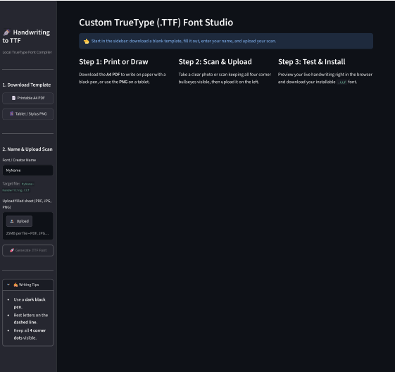
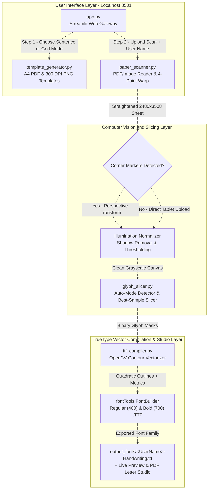

# Handwriting to TTF

A local web application (`http://localhost:8501`) for turning your own handwriting into installable **Regular** and **Bold** TrueType (`.ttf`) fonts from a printed A4 template or tablet scan using OpenCV, FPDF2, and fontTools.

## About

Handwriting to TTF provides a lightweight, local-first pipeline for generating printable **Sentence Flow** and **Classic Grid** character templates, straightening perspective from scanned sheets or camera photos, isolating pen strokes, compiling custom `.ttf` font families, and converting typed text or PDFs into your own handwriting—without external cloud dependencies.

Built and maintained by [T A Srinivas (@SRINIVASTA)](https://github.com/SRINIVASTA), this repository hosts a Streamlit web gateway, a dual-mode A4 template generator, a 4-point corner marker perspective scanner, an auto-detecting glyph slicer, a vector TrueType font compiler, and a handwritten letter/PDF studio.

### ⭐ Show Your Support

If you clone, test, or build upon **Handwriting to TTF**, please consider giving this repository a **Star ⭐** on GitHub—it helps others discover the project and supports continued development!



## Modules in this repo

| Module | Description |
| :--- | :--- |
| `template_generator.py` | Generates printable exact-scale A4 PDF and 300 DPI PNG templates in both **Sentence Flow** (guided pangram lines for natural handwriting rhythm) and **Classic Grid** (`11x8` character boxes) modes with 4 corner bullseye markers. |
| `paper_scanner.py` | Reads uploaded PDF scans (via `pdf2image`) or phone photos, detects the 4 corner registration markers, straightens perspective to a canonical `2480x3508` canvas, and removes paper shadows. |
| `glyph_slicer.py` | Auto-detects **Sentence Flow** vs. **Classic Grid** templates via top-center fiducial marker, crops all 88 character slots, scores duplicate letters in sentences to pick the cleanest sample, and isolates binary pen strokes. |
| `ttf_compiler.py` | Traces OpenCV contours into smooth quadratic TrueType outlines via `fontTools`, enforces TrueType contour winding order, and exports both `<UserName>-Handwriting.ttf` (Regular) and `<UserName>-Handwriting-Bold.ttf` (Bold). |
| `letter_printer.py` | Renders live HTML previews and exports ready-to-print A4 PDFs using your compiled Regular & Bold handwriting fonts, including an optional converter that rewrites existing typed PDFs into your handwriting. |

### Architecture & Workflow



### Key Capabilities

* **Sentence Flow & Classic Grid Modes:** Choose **Sentence Flow** to write natural pangram sentences along a continuous baseline (with automatic best-sample selection for repeated vowels/consonants) or **Classic Grid** for isolated character boxes.
* **Paper & Tablet Ready:** Download an exact-scale A4 PDF to print and fill with a bold black pen, or download a 300 DPI PNG to write directly on an iPad, Android tablet, or phone screen.
* **Automatic Perspective & Shadow Correction:** Detects the 4 corner bullseye markers to deskew tilted phone photos and normalizes uneven lighting before slicing characters.
* **Regular & Bold Font Family Export:** Generates both `<UserName>-Handwriting.ttf` and `<UserName>-Handwriting-Bold.ttf` with proper glyph winding and embedded font family metadata.
* **Live Preview & Letter/PDF Converter Studio:** Test typing immediately inside the browser, compose formatted handwritten letters, or convert existing typed PDFs into your custom handwriting.

## Repository Structure

```text
handwriting-to-ttf/
├── .streamlit/
│   └── config.toml                      # Streamlit theme settings and 50 MB upload limit
├── assets/
│   └── desktop.png                      # Application UI preview screenshot
├── output_fonts/
│   ├── <UserName>-Handwriting.ttf       # Compiled Regular (400) TrueType font
│   └── <UserName>-Handwriting-Bold.ttf  # Compiled Bold (700) TrueType font
├── samples/
│   ├── blank_template_sentence.pdf      # Printable A4 PDF template (Sentence Flow mode)
│   ├── blank_template_sentence.png      # 300 DPI PNG template (Sentence Flow mode)
│   ├── sample_filled_paper_sentence.pdf # Example filled Sentence Flow PDF
│   ├── blank_template.pdf               # Printable A4 PDF template (Classic Grid mode)
│   ├── blank_template.png               # 300 DPI PNG template (Classic Grid mode)
│   └── sample_filled_paper.pdf          # Example filled Classic Grid PDF
├── src/
│   ├── __init__.py                      # Shared 88-character map and A4 canvas constants
│   ├── template_generator.py            # Generates Sentence Flow & Classic Grid PDF/PNG templates
│   ├── paper_scanner.py                 # Reads PDF/image scan, straightens perspective, cleans paper
│   ├── glyph_slicer.py                  # Auto-detects template mode and isolates clean pen strokes
│   ├── ttf_compiler.py                  # Converts character contours into Regular & Bold .ttf fonts
│   └── letter_printer.py                # Renders handwritten letters and converts PDFs to custom font
├── .gitignore                           # Ignores venv/, __pycache__/, and generated .ttf fonts
├── app.py                               # Streamlit web UI (Templates -> Scan -> .TTF -> Letter Studio)
├── LICENSE                              # MIT License — Copyright (c) 2026 T A Srinivas
├── packages.txt                         # System dependency (poppler-utils) for reading uploaded PDF scans
├── requirements.txt                     # Python dependencies (streamlit, fpdf2, pdf2image, opencv, fonttools)
└── README.md                            # Setup guide, usage instructions, and architecture diagram
```

## Installation & Local Setup

You can clone and run **Handwriting to TTF** locally across Windows, macOS, and Linux:

### 1. Clone the repository

```bash
git clone https://github.com
cd handwriting-to-ttf
```

### 2. Install system PDF dependencies

*(Required only if uploading scanned `.pdf` files; `.png` and `.jpg` uploads work out of the box.)*

#### Windows
1. Download and install **Poppler for Windows**.
2. Add the Poppler `bin` folder to your Windows **System PATH**.

#### Ubuntu / Debian
```bash
sudo apt-get update && sudo apt-get install -y poppler-utils
```

#### macOS
```bash
brew install poppler
```

### 3. Set up Python environment

```bash
# Create virtual environment
python -m venv venv

# Activate on Windows
venv\Scripts\activate

# Activate on macOS / Linux
source venv/bin/activate

# Install dependencies
pip install -r requirements.txt
```

### 4. Generate blank & sample templates (Optional)

```bash
python -m src.template_generator
```

### 5. Launch the application

```bash
streamlit run app.py
```

Open your browser and navigate to `http://localhost:8501`.

## ⚠️ Disclaimer & Ethical Typography Governance

This project is an **AI-assisted computer vision and vector typography platform** intended strictly for educational, research, portfolio demonstration, and authorized creative design purposes. Users must only digitize handwriting that they own or for which they hold explicit, verifiable consent. Any unauthorized replication of another individual's handwriting, signature forgery, or deceptive document generation is strictly prohibited.

## 📄 License

This project is licensed under the **MIT License** — Copyright (c) 2026 **T A Srinivas**. See the [LICENSE](LICENSE) file for full details.

For enterprise deployment, custom integrations, or commercial inquiries, feel free to reach out at **`tasrinivass@gmail.com`**.

* **Lead Architect & Developer:** [T A Srinivas (@SRINIVASTA)](https://github.com/SRINIVASTA)

### 🌐 Let’s Connect

[](https://www.linkedin.com/in/srinivas-t-a-557637119/)
[](https://www.kaggle.com/srinivasta)
[](mailto:tasrinivass@gmail.com)
[](https://github.com/srinivasta)
[](https://srinivasta.github.io)

💡 Engineered with 4-point perspective transformation, illumination normalization, dual-mode (Sentence Flow & Grid) glyph slicing, and quadratic contour vectorization to transform handwritten A4 sheets into installable TrueType font families.
